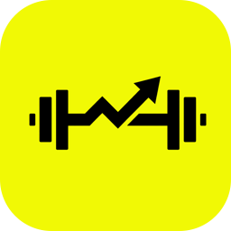

  

<h1 align="center">Lift</h1>

<strong>A gym log for iPhone and Apple Watch.</strong> 
Build your routines, log every set in a few taps and see yourself improve. No account, no ads.

<!-- Once the app is live: replace the line below with Apple's official "Download on the App Store" badge (Apple marketing
     resources) linking to https://apps.apple.com/app/id… -->

<strong>Coming soon to the App Store</strong>

## What it does

- **Your routines:** training days, exercises from a catalog of 260+ or your own, sets, reps, grips and techniques such as drop sets, rest-pause, supersets, myo-reps and pyramids.
- **Fast workouts:** your last set always in view, a rest timer, swap or skip an exercise just for today.
- **Apple Watch:** log sets from your wrist with live heart rate and calories; the workout is saved to Apple Health.
- **Always at hand:** Live Activity on the Lock Screen and in the Dynamic Island, widgets, Control Center and Siri to start your next workout.
- **Progress:** charts and records for each exercise, weekly sets by muscle group, a workout diary and a monthly recap.
- **Private by design:** your data stays on your iPhone and Apple Watch and never reaches the developer. No account, no servers, no ads, no tracking.

  <a href="https://matteopiccadaci.github.io/lift_app/en">Privacy Policy</a> ·
  <a href="mailto:matteopiccadaci02@gmail.com">Support</a>

